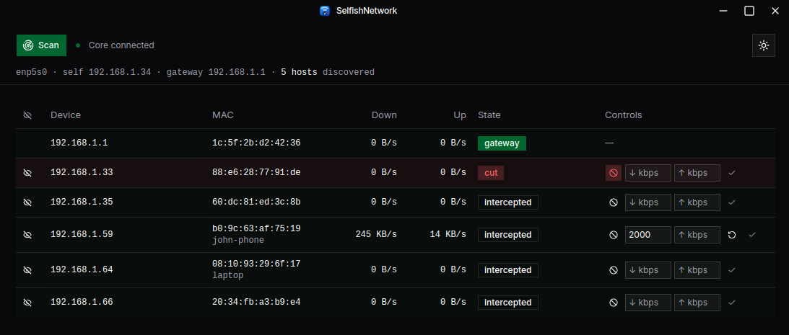

# SelfishNetwork

A cross-platform (v1: **Linux**) tool for managing your own local network via ARP
interception — discover devices, and cut or throttle their bandwidth.



## Architecture

Two processes, split by privilege:

```
┌─────────────────────────────┐        ┌──────────────────────────────┐
│  Electron UI (unprivileged) │  WS    │  Rust core daemon (root-ish)  │
│  React + TS + Vite          │◄──────►│  net_raw/net_admin/dac_override│
│  device list, live graphs   │ JSON   │  ARP scan · ARP spoof (MITM)  │
│  cut / throttle controls    │ :8734  │  userspace fwd · token bucket │
└─────────────────────────────┘        └──────────────────────────────┘
```

- **`core/`** — Rust daemon. Does the privileged work: ARP discovery, MITM via
  bidirectional ARP spoofing, userspace L2 forwarding with a per-device token
  bucket (cut = stop forwarding). Serves a localhost WebSocket. See
  [`core/README.md`](core/README.md).
- **`ui/`** — Electron + React/TypeScript. Runs as your user, connects only to
  `127.0.0.1:8734`, never touches raw sockets.
- **`scripts/`** — `setcap` installer so the core runs without a password prompt,
  and a dev launcher.

The WS message contract shared by both sides lives in
[`docs/protocol.md`](docs/protocol.md).

## Quick start (dev)

```bash
# 1. build the core and grant it capabilities (asks for sudo once)
./scripts/setcap-core.sh

# 2. run core + UI together
./scripts/dev.sh
```

## Install (Linux)

Build a `.deb` and an `.AppImage` — both bundle the compiled core daemon and
grant it the required capabilities automatically (the `.deb`'s postinstall
script runs `setcap`; see `ui/build/deb-after-install.sh`):

```bash
cd core && cargo build --release && cd ..
cd ui && npm install && npm run dist:linux
```

Output lands in `ui/release/`:

- `SelfishNetwork-<version>.AppImage` — portable, no install step. Capabilities
  aren't set automatically for it (the squashfs is read-only); if ARP
  spoofing/forwarding doesn't start, extract it once (`./SelfishNetwork-*.AppImage --appimage-extract`)
  and run `sudo setcap cap_net_raw,cap_net_admin,cap_dac_override+ep squashfs-root/resources/bin/selfishnet-core`.
- `selfishnet-ui_<version>_amd64.deb` — `sudo dpkg -i ui/release/selfishnet-ui_*.deb`
  installs to `/opt/SelfishNetwork` and adds a desktop launcher.

## Status

Functional on Linux. Device discovery, ARP-spoof MITM, userspace forwarding,
per-device **cut** and **throttle**, and live bandwidth stats all work; ARP
caches and kernel sysctls are restored on release/exit. See
[`core/README.md`](core/README.md#how-forwarding-works) for how the data plane
works and its v1 limits (IPv4-only forwarding, drop-based throttling).
